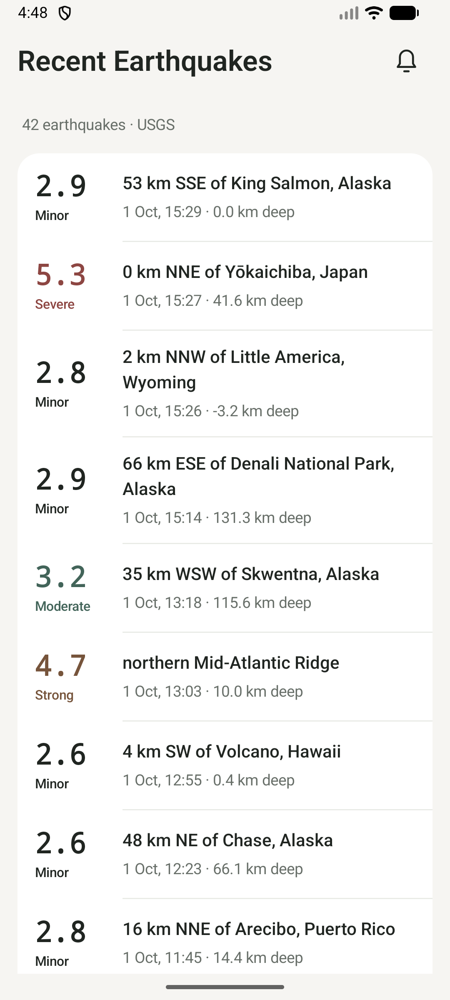
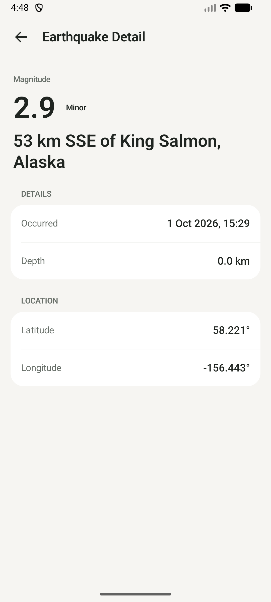
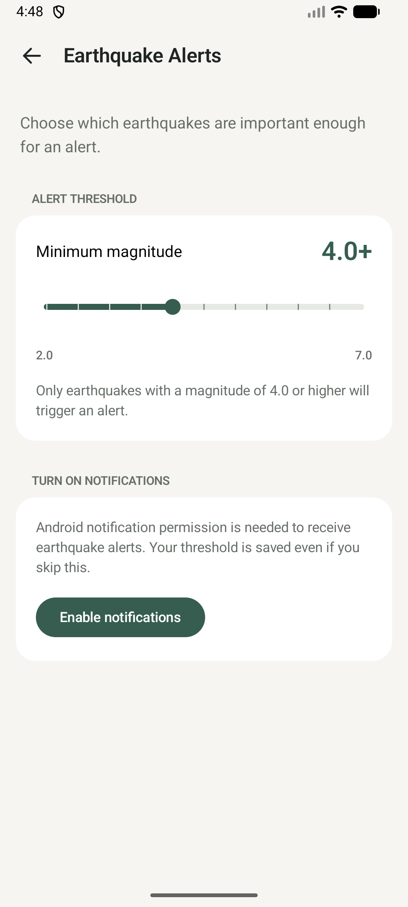

# Earthquake Alerts

A native Android case study built with Kotlin and Jetpack Compose. It shows recent earthquakes from the USGS feed, keeps a local cache for offline viewing, and lets users choose a minimum magnitude for periodic earthquake notifications.

The feed currently covers the USGS query results globally; it is not limited to Turkey or the device's location.

## Screenshots

Screenshots have not been added to this repository yet. Add captures here before submission:

| Home                          | Earthquake Detail                            | Earthquake Alerts                            |
|-------------------------------|----------------------------------------------|----------------------------------------------|
|  |  |  |

## Features

- Recent USGS earthquakes with magnitude, place, local time, severity, and depth when available.
- Cached Home feed, pull-to-refresh, empty/error states, and a Detail screen with coordinates.
- Alert threshold persisted in DataStore: default **4.0**, range **2.0–7.0** in **0.5** steps.
- Periodic background checks with persistent duplicate prevention and Android notifications.
- Notification tap navigation to the corresponding locally stored earthquake Detail.
- Structured product events written locally to Logcat.

## Tech Stack

| Area | Current project choice |
| --- | --- |
| UI | Jetpack Compose, Material 3 |
| Language / build | Kotlin 2.2.10, Android Gradle Plugin 9.3.3, Gradle wrapper 9.5.0 |
| Presentation | MVVM, Lifecycle ViewModel and lifecycle-aware Compose collection |
| Networking | Retrofit 3.0.0, OkHttp 4.12.0, official USGS GeoJSON API |
| Serialization | Kotlin Serialization 1.9.0 |
| Local data | Room 2.8.5 |
| Preferences | DataStore Preferences 1.2.1 |
| Background work | WorkManager 2.12.0 |
| Dependency injection | Hilt 2.60.1 |
| Async / navigation | Coroutines and Flow 1.10.2; Navigation Compose 2.10.2 |


The app is a single module. Presentation uses MVVM; domain models and repository interfaces separate screen behavior from Retrofit, Room, and DataStore details. Hilt connects those interfaces to their data implementations.

## Architecture

```text
Compose screens → ViewModels → domain models / repository interfaces
                                      │
                    data implementations (Retrofit + Room + DataStore)

WorkManager → CheckEarthquakeAlerts → processed IDs in Room
                                  → Android notification manager
```

The important packages are `presentation` (Home, Detail, Settings, navigation), `domain` (models, contracts, alert rule), `data` (USGS, mapping, Room, DataStore, repositories), `worker`, `notification`, `analytics`, and `di`. DTOs and Room entities do not reach the presentation layer. A dedicated use case exists for alert checking because it combines several repositories and a business rule; simple data access stays in the repository.

## Data Flow

```text
USGS → Retrofit → EarthquakeRepositoryImpl → Room
                                           → DAO Flow → HomeViewModel → Compose
```

Home observes Room rather than rendering the network response directly. A successful refresh validates and stores USGS data, after which Room emits the new feed; a failed request leaves the cached feed in place.

The `earthquakes` table retains event records for ID-based Detail lookup. A separate `home_feed` table holds the IDs currently visible on Home. A successful Home refresh replaces that membership in a Room transaction, including a genuinely empty response. An alert check may upsert earthquake records without changing Home membership. If USGS returns features but none are usable, the refresh fails and the existing Home feed is retained.

The default Home request covers approximately the past 24 hours with minimum magnitude **2.5** and at most **100** results. GeoJSON coordinates are mapped in **longitude, latitude, depth** order; unusable events are skipped while valid ones remain.

## Earthquake Alerts

```text
WorkManager (network required)
  → read the persisted threshold
  → fetch recent USGS earthquakes (magnitude ≥ 2.0, up to 500)
  → claim newly seen USGS IDs in Room
  → select events with magnitude ≥ threshold
  → post Android notification → tap opens Detail by earthquake ID
```

`EarthquakeApplication` schedules one unique periodic `EarthquakeAlertWorker` with a requested **15-minute** interval and a connected-network constraint. The threshold lives in DataStore. On Android 13+, notification permission is requested from Alert Settings when the user chooses to enable notifications, not on app launch. Notification display also checks the current permission and system notification setting.

### Alert semantics

The first successful background check silently records the existing earthquakes as a baseline. Later checks consider only newly discovered USGS IDs; even below-threshold events are marked processed, so lowering the threshold does not alert on old events. IDs are claimed in a Room transaction **before** notification delivery. This prevents repeated attempts for the same ID, but a failed or blocked delivery can leave an alert unsent: the policy is **at-most-once notification attempt**, not guaranteed delivery.

### Why WorkManager?

WorkManager fits persistent, deferrable background checks and can wait for connectivity. **It is not a real-time earthquake alert mechanism:** Android may delay periodic work, and the 15-minute interval is not an exact schedule. If timely production alerts were required, the intended architecture would be **USGS/data provider → backend monitoring → FCM → Android device**. That infrastructure is outside this case study's scope.

## Offline Behavior

Room is the local source of truth for Home. Previously cached events remain visible if a later network refresh fails; the UI shows a non-blocking refresh error. Without cached events, the same failure shows a blocking error with Retry. Detail looks up its ID in local storage, so a stored event can be viewed without another API call; an unknown ID shows a not-found state.

## Product Analytics

The case study also asks how to measure whether users reach and benefit from the product. `AnalyticsTracker` accepts structured `AnalyticsEvent` values; `LocalAnalyticsTracker` currently emits them **only to Logcat**, under the `EarthquakeAnalytics` tag. Nothing is uploaded.

| Product question | Representative current events |
| --- | --- |
| Activation | `app_opened`, `notification_threshold_changed`, `notification_permission_result` |
| Engagement | `earthquake_list_viewed`, `earthquake_selected`, `earthquake_list_refreshed` |
| Core value | `earthquake_notification_sent`, `earthquake_notification_opened` |
| Reliability | No dedicated failure telemetry yet; build/tests and error states provide development feedback, not production metrics. |

`earthquake_notification_sent` means Android's `notify()` call returned; it does not prove the user saw the alert. Event triggers and parameters are listed in [ANALYTICS.md](ANALYTICS.md).

## Getting Started

1. Clone or download the repository and open its root in Android Studio.
2. Install the Android SDK requested by Gradle (compile SDK **37.1**); the project compiles for Java **17** and supports Android **7.0 / API 24** and later.
3. Let Android Studio sync the included Gradle wrapper and dependencies.
4. Run the `app` configuration on an emulator or device. A network connection is needed for a fresh USGS feed.
5. Open Earthquake Alerts to set the threshold. On Android 13+, grant notification permission there if you want notifications.

The USGS endpoint needs **no API key or secret configuration**. Background checks are deferred by Android; opening the app or adjusting the slider does not immediately send a test notification.

## Verification

From the project root:

```bash
./gradlew build testDebugUnitTest lint
```

The latest run of this combined command **passed**. It reported **54 passing unit tests, 0 failures, 0 lint errors, and 14 lint warnings**. The warnings are mostly version/target update suggestions; two identify unused string resources. These values describe the current checkout and can change with future edits or tooling updates.

## Testing

Local JVM tests cover GeoJSON and Room mapping, repository refresh/cache behavior, Home/Detail/Settings ViewModel states, DataStore defaults and failures, first-run baseline and alert deduplication, and notification analytics. Fake APIs, DAOs, and repositories keep business rules deterministic without a mocking library.

This suite does **not** verify live USGS integration, actual Android notification delivery or tap behavior, real Room migration upgrades, WorkManager scheduling by the OS, or Compose screenshots. Those require separate device/instrumentation or integration checks.

## Key Technical Decisions

| Decision | Reason |
| --- | --- |
| Room-backed Home feed | Keeps a usable list after network failure and emits updates through Flow. |
| Separate `home_feed` membership | Refresh shows the current feed while older earthquake records can still resolve Detail IDs. |
| Pass only earthquake ID to Detail | Small navigation argument; Detail reads the stored record by ID. |
| DataStore for threshold | One persistent preference with asynchronous Flow observation. |
| WorkManager for checks | Persistent, connectivity-constrained background work without a backend. |
| Persist processed USGS IDs | Prevents repeat alert attempts across process restarts and threshold changes. |
| Local analytics interface | Captures meaningful product events without adding an external SDK. |


## AI Usage

AI-assisted development tools were used during the case study. Detailed workflow, delegated tasks, review, corrections, and verification will be documented separately in `AI_USAGE_REPORT.md` before submission. That report is not yet present in this repository.
